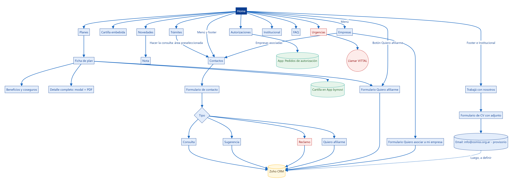
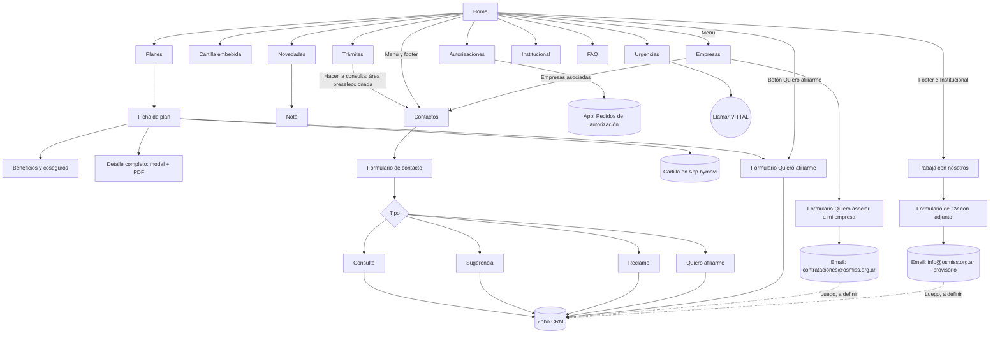

# Mapa del sitio — Nuevo sitio web OSMISS

Documento de referencia para el equipo de desarrollo web. Describe la estructura, las secciones, los
contenidos y las integraciones del nuevo sitio público de OSMISS, tal como quedaron definidos en el
prototipo funcional.

- **Prototipo navegable:** repositorio `github.com/eneue2020/web` (React + Vite). Correr `npm install` y `npm run dev`.
- **Alcance de referencia:** "Propuesta Web - Osmiss V2" (sitio público + Backoffice + integración con Zoho CRM).
- **Contenidos reales** tomados de osmiss.org.ar: FAQ, contactos, trámites, dirección, beneficios,
  coseguros, descripción de planes y urgencias. **Contenidos de ejemplo** (a reemplazar): ver
  [Pendientes](#9-pendientes-y-puntos-a-validar).

---

## 1. Árbol del sitio

```
OSMISS (sitio público)
│
├── Home ............................................. /
│
├── Planes ........................................... /planes
│   ├── OSMISS-100 ................................... /planes/osmiss-100
│   ├── OSMISS-150 ................................... /planes/osmiss-150
│   ├── OSMISS-200 ................................... /planes/osmiss-200
│   └── OSMISS-500  ★ plan destacado ................. /planes/osmiss-500
│        (cada ficha: Beneficios · Ver Detalle Completo [modal + PDF] · Ver cartilla · Quiero afiliarme)
│
├── Cartilla ......................................... /cartilla
├── Novedades ........................................ /novedades
│   └── Nota ......................................... /novedades/{id-de-la-nota}
├── Prevención ....................................... /prevencion
├── Institucional .................................... /institucional
│   ├── Quiénes somos (misión, visión, valores)
│   ├── ¿Por qué elegirnos?
│   ├── Dirección (autoridades)
│   └── Instituciones vinculadas
├── FAQ .............................................. /faq
├── Trámites ......................................... /tramites
├── Autorizaciones ................................... /autorizaciones
├── Empresas ("Quiero asociar a mi empresa") ........ /empresas
├── Contactos ........................................ /contactos
│   └── Con área preseleccionada ..................... /contactos/{area}
├── Urgencias ........................................ /urgencias
├── Trabajá con nosotros (envío de CV) ............... /trabaja-con-nosotros
│        (acceso desde el footer e Institucional, no está en el menú principal)
│
└── Quiero afiliarme (formulario) .................... /afiliarme
    └── Con plan preseleccionado ..................... /afiliarme/{plan}
```

> En el prototipo las rutas usan hash (`#planes/osmiss-100`). En producción deben ser **URLs amigables**
> (`/planes/osmiss-100`) por SEO, como indica la propuesta (metadata, sitemap y Open Graph por página).



Versiones de la imagen (fondo transparente): [PNG](docs/mapa-del-sitio.png) · [SVG](docs/mapa-del-sitio.svg).
Código fuente del diagrama (Mermaid):



> Todos los formularios terminan en **Zoho CRM** (y se guardan en el Backoffice). El campo **Tipo** del
> formulario de Contactos (Consulta / Sugerencia / Reclamo / Quiero afiliarme) y el campo **Área** se envían
> al CRM para que cada caso se derive al sector correspondiente. La configuración de flujos en Zoho
> (por ejemplo, que los reclamos generen un caso o ticket) está a cargo de OSMISS y su proveedor.

---

## 2. Elementos globales (en todas las páginas)

| Elemento | Escritorio / tablet | Celular |
|---|---|---|
| **Barra de urgencias** (roja, fija arriba) | "Urgencias y emergencias 24 hs" + 0810-333-8888 y (011) 4000-8888 clickeables + "Más información" → /urgencias | Se oculta (la reemplaza el botón flotante) |
| **Menú principal** (fijo) | Home · Planes · Cartilla · Novedades · Prevención · Institucional · FAQ · Trámites · Autorizaciones · **Empresas** · Contactos · **Urgencias** (en rojo) + botón **Quiero afiliarme** | Menú hamburguesa (☰) por debajo de 1340 px |
| **Botón flotante Urgencias** | — | Botón rojo fijo abajo a la derecha; despliega panel con 2 botones "Llamar al…" (no aparece dentro de /urgencias) |
| **Footer** | Logo · Navegación · Planes · Contacto (urgencias 24 hs, teléfonos, email, dirección, horario) · Quiero afiliarme · Instituciones vinculadas · RNOS, CUIT y SSSalud | Igual, en una columna |

---

## 3. Páginas

### 3.1 Home `/`
Orden de bloques:
1. **Carrusel principal** — 4 slides (2 de planes, 2 de noticias). Cada slide: tipo, título, bajada, CTA, destino, orden, activo, imagen desktop e imagen mobile. Avance automático cada 5 s, flechas y puntos, pausa al pasar el mouse.
2. **Accesos rápidos** — Autorizaciones (App) · Cartilla · Credencial digital (App) · Urgencias 24 hs (llamada directa).
3. **Nuestros planes** — 4 cards. **OSMISS-500 destacado** (cinta "★ PLAN SUPERADOR", color y tamaño mayor). Cada card: "Ver cobertura" (→ ficha) y "Ver cartilla" (→ App).
4. **¿Por qué elegirnos?** — 4 motivos con ícono.
5. **Nuestros prestadores** — carrusel horizontal continuo de logos + botón "Ver la cartilla completa".
6. **Últimas novedades** — 3 notas + "Ver todas las novedades".
7. **CTA "Quiero afiliarme"** — banda destacada.

### 3.2 Planes `/planes`
- Grilla de las 4 cards (igual que en Home).
- **Tabla comparativa** de planes (columna del OSMISS-500 resaltada).
- CTA "Quiero afiliarme".

### 3.3 Ficha de plan `/planes/{plan}`
- Imagen, nombre, bajada y descripción.
- Botones:
  - **Quiero afiliarme** → /afiliarme/{plan} (plan preseleccionado en el formulario).
  - **Beneficios** → despliega en la página el **cuadro de beneficios** y la pestaña de **coseguros**, con buscador, filtro por categoría, colores por tipo de cobertura (verde: sin cargo/100%; rojo: no cubierto) y referencias (ST, SL, SC, CC).
  - **Ver cartilla** → App bymovi `/cartilla` (pestaña nueva).
  - **Ver Detalle Completo** → **modal** con la descripción completa del plan (20 capítulos, índice navegable; en celular, selector de capítulos) y botón **Descargar PDF**.
- Tarjetas: Características · Beneficios · Información adicional.

### 3.4 Cartilla `/cartilla`
- Cartilla de bymovi **embebida** (iframe), recortando su menú lateral y su barra superior para que se vea integrada al sitio.
- Link "Abrir la cartilla en la App OSMISS" (pantalla completa).

### 3.5 Novedades `/novedades` y `/novedades/{id-de-la-nota}`
- Listado de notas (fecha, título, resumen, "Leer más").
- Ficha de nota: fecha, título, resumen y cuerpo.

### 3.6 Prevención `/prevencion`
- Tarjetas con consejos de prevención.

### 3.7 Institucional `/institucional`
1. **Quiénes somos** — introducción + Misión, Visión y Valores.
2. **¿Por qué elegirnos?**
3. **Dirección** — foto y nombre del presidente, marco legal (RNOS 0-0250-1, Res. SSS 027/04 y 309/05, Leyes 23.660 y 23.661, Certificado 1976/04) y conducción completa (incluye Comisión Revisora de Cuentas).
4. **Instituciones vinculadas** — logos: SSSalud, Círculo de Ministros, Mutualidad del Círculo (con link), Fipem y Funsalud (sin link por ahora).

### 3.8 FAQ `/faq`
- Pestañas por categoría: **Sumate a OSMISS** · **Atención y cobertura** · **Medicamentos** (preguntas del sitio actual reescritas con foco en captar afiliados, más urgencias y discapacidad).
- Acordeones; respuestas con párrafos, listas y uno o más botones de acción, internos o externos (ej.: "Quiero afiliarme", "Ver urgencias", "Ver el manual de prestaciones" de discapacidad en Drive).
- Banda final: "¿Te quedó alguna duda?" → Quiero afiliarme / Hacer una consulta.

### 3.9 Trámites `/tramites`
1. **App OSMISS (osmiss-bymovi)** — funciones (credencial digital, autorizaciones, cartilla, trámites, emergencias, notificaciones), botones "Ingresar a la app", **Google Play (Android)** y **App Store (iPhone)**.
1. **¿Cómo empiezo a usar la app?** — pasos para la versión web (sin instalar) y para la app del celular (registro una sola vez, usuario = DNI), con los botones de cada versión y link al instructivo de uso.
2. **¿Qué trámite necesitás hacer?** — una tarjeta por sector:
   - **Afiliaciones** (afiliados y empleadores)
   - **Gerencia Médica** (afiliados y efectores) — incluye botón "Pedir autorización"
   - **Control de Aportes** (afiliados y empleadores)
   - **Otras consultas** (público general)

   Cada tarjeta: lista de trámites, **Hacer la consulta** (→ /contactos/{area}) y email del sector.
3. Recomendaciones para la consulta y teléfonos.

### 3.10 Autorizaciones `/autorizaciones`
- Botón principal **Pedir autorización en la App** → App bymovi `/pedidos-autorizacion`.
- Link al **paso a paso de registro** en la App.
- 4 pasos del trámite.
- Qué es una autorización · Quiénes pueden usar la App · Consultas a autorizaciones@osmiss.org.ar.

### 3.10 bis Empresas `/empresas`
- Encabezado **"Quiero asociar a mi empresa"** + botones "Quiero asociar a mi empresa" (baja al formulario) y "Ver planes".
- "¿Por qué elegir OSMISS para tu empresa?" (3 beneficios, textos a validar).
- **Formulario "Quiero asociar a mi empresa"** (ver [Formularios](#5-formularios)) → por ahora a **contrataciones@osmiss.org.ar**;
  luego ingresará al CRM (a definir). Debajo del formulario se ofrece también escribir directo a esa dirección (mailto).
- **¿Tu empresa ya está asociada?** (contenido de osmiss.org.ar/empresas.html): Control de aportes y Afiliaciones,
  cada uno con "Hacer la consulta" (→ /contactos/{area}) y su email; teléfonos y horario; aviso de que solo
  Casa Central confirma afiliaciones e imputación de aportes.

### 3.11 Contactos `/contactos` y `/contactos/{area}`
- **Canales**: teléfono, 0800 interior, email y App (clickeables).
- **Formulario de contacto / sugerencias / reclamos** (ver [Formularios](#5-formularios)).
- **Casa Central**: dirección, horario, mapa de Google y "Cómo llegar".
- **Emails por área** (5 áreas).
- **Superintendencia de Servicios de Salud**: teléfono, horario, dirección; RNOS y CUIT.

### 3.12 Urgencias `/urgencias`
- Números del **Centro Coordinador de Urgencias (VITTAL)** en grande, "Tocá para llamar": **0810-333-8888** y **(011) 4000-8888** — 24 hs, 365 días.
- Servicios: emergencias, urgencias y médico a domicilio. (No incluir telemedicina: OSMISS no ofrece este servicio por ahora.)
- Qué tener a mano · Emergencias sin cargo (código rojo) · Números públicos 107 (SAME) y 911.

### 3.13 Quiero afiliarme `/afiliarme` y `/afiliarme/{plan}`
- Formulario de afiliación (ver [Formularios](#5-formularios)).

### 3.14 Trabajá con nosotros `/trabaja-con-nosotros`
- Encabezado: **"¿Querés formar parte de nuestro equipo? Envianos tu CV"** + botón "Enviar mi CV".
- "¿Por qué trabajar en OSMISS?" (3 motivos).
- **Formulario de CV** con archivo adjunto (ver [Formularios](#5-formularios)).
- Accesos: footer (destacado y en Navegación) y banda al final de Institucional.

---

## 4. Enlaces externos

| Destino | URL | Desde |
|---|---|---|
| App de afiliados (inicio) | https://osmiss-app.bymovi.com/ | Trámites, Contactos |
| Cartilla | https://osmiss-app.bymovi.com/cartilla | "Ver cartilla", Cartilla embebida |
| Pedidos de autorización | https://osmiss-app.bymovi.com/pedidos-autorizacion | Autorizaciones, accesos rápidos, Trámites |
| Credencial digital | https://osmiss-app.bymovi.com/credencial-digital | Accesos rápidos |
| App en Google Play (Android) | https://play.google.com/store/apps/details?id=com.webexport.osmiss | Trámites, Autorizaciones, footer |
| App en App Store (iPhone) | https://apps.apple.com/ar/app/osmiss/id6778929323 | Trámites, Autorizaciones, footer |
| Nota "Nueva app OSMISS-bymovi" | https://osmiss.org.ar/news2/2026/05/22/nueva-app-osmiss-bymovi/ | Trámites ("Más información") |
| Paso a paso de registro (PDF en Drive) | https://drive.google.com/file/d/1W7dtKNdsi2H_fvHa0HoBH7wYHoMxYGVg/view | Autorizaciones |
| SSSalud | https://www.argentina.gob.ar/sssalud | Institucional, footer |
| Círculo de Ministros | http://circulodeministros.com.ar/ | Institucional, footer |
| Mutualidad del Círculo | https://www.mutualdelcirculodeministros.org.ar/ | Institucional, footer |
| Mapa Casa Central | https://maps.app.goo.gl/6KXKt7Ua6w6kS43D9 | Contactos |

> Las pantallas de la App (salvo cartilla) requieren inicio de sesión del afiliado.

---

## 5. Formularios

Todos con confirmación de envío, validación, protección antispam (campo trampa; en producción sumar
validación en backend) y envío a **Zoho CRM** vía API (en el prototipo: `config.formulariosApi`, vacío = modo demo).
Deben guardarse también en el Backoffice, según la propuesta.

| Formulario | Ruta | Campos (* obligatorio) |
|---|---|---|
| **Quiero afiliarme** | /afiliarme | Nombre*, Apellido*, DNI* (7-8 dígitos), Fecha de nacimiento*, Teléfono*, Email*, Plan de interés, Comentarios |
| **Contacto / Sugerencias / Reclamos** | /contactos | Tipo* (Quiero afiliarme / Consulta / Sugerencia / Reclamo), Área (Afiliaciones / Gerencia Médica / Control de Aportes / Otras consultas), Nombre*, Apellido*, Email*, Teléfono*, DNI/CUIL/CUIT, Mensaje* |
| **Quiero asociar a mi empresa** | /empresas | Razón social*, CUIT* (11 dígitos, con o sin guiones), Cantidad de empleados* (1 a 10 / 11 a 50 / 51 a 200 / Más de 200), Rubro, Localidad*, Provincia*, Contacto (nombre y apellido)*, Cargo, Email*, Teléfono*, Comentarios |
| **Envío de CV** | /trabaja-con-nosotros | Nombre*, Apellido*, Email*, Teléfono*, Área de interés*, CV* (PDF/DOC/DOCX, máx. 5 MB), Mensaje, Consentimiento* para guardar los datos |

> El formulario de CV se envía como `multipart/form-data` (por el archivo adjunto) con `formulario: "cv"`
> y `destinatario: "info@osmiss.org.ar"`. **Los CV deben llegar a info@osmiss.org.ar** (con el archivo adjunto).
> **Destino provisorio:** OSMISS va a definir un email específico para RRHH; tomarlo de configuración, no fijo en el código.
> **Recorrido previsto:** formulario → email → **ingreso al CRM (a definir)**. Queda por definir si el CV
> entra a Zoho CRM directamente desde el formulario (como el resto) o a partir del email específico de RRHH.
> Este flujo no estaba en el alcance de integración con Zoho de la propuesta (afiliación, reclamos y consultas),
> por lo que hay que confirmarlo con OSMISS y su proveedor de Zoho. Respetar la Ley 25.326 de datos personales.
> En la página también se ofrece enviarlo directamente a esa dirección (link mailto).

**Envío a Zoho CRM** — cada envío es un JSON con todos los campos del formulario más `formulario`,
que indica de dónde viene. En Contactos, el campo `tipo` indica la categoría elegida y `area`, el sector:

| Formulario / Tipo elegido | Datos clave enviados | Uso sugerido en Zoho |
|---|---|---|
| Quiero afiliarme (formulario de afiliación) | `formulario: "afiliacion"`, `plan` | Lead / potencial afiliado |
| Contactos → **Quiero afiliarme** | `formulario: "contacto"`, `tipo: "Quiero afiliarme"` | Lead / potencial afiliado |
| Contactos → **Consulta** | `formulario: "contacto"`, `tipo: "Consulta"`, `area` | Consulta, derivada por Área |
| Contactos → **Sugerencia** | `formulario: "contacto"`, `tipo: "Sugerencia"`, `area` | Sugerencia |
| **Quiero asociar a mi empresa** | `formulario: "empresa"`, `destinatario: "contrataciones@osmiss.org.ar"`, `cuit`, `empleados` | **Por ahora por email a contrataciones@osmiss.org.ar**; luego, lead de empresa (B2B) en el CRM (a definir) |
| Contactos → **Reclamo** | `formulario: "contacto"`, `tipo: "Reclamo"`, `area` | Caso / ticket de reclamo, derivado por Área |

Ejemplo de un reclamo:

```json
{
  "formulario": "contacto",
  "tipo": "Reclamo",
  "area": "Gerencia Médica",
  "nombre": "Ana",
  "apellido": "Pérez",
  "email": "ana@ejemplo.com",
  "telefono": "11 5555-5555",
  "dni": "30111222",
  "mensaje": "Texto del reclamo"
}
```

Accesos al formulario de Contactos: menú principal, footer, banda final de FAQ ("Hacer una consulta"),
tarjetas de Trámites ("Hacer la consulta", con el Área preseleccionada) y tarjetas de Autorizaciones.

---

## 6. Contenido administrable (Backoffice)

Correspondencia entre los contenidos del sitio y los módulos de Backoffice de la propuesta:

| Módulo BO | Contenido | Campos principales |
|---|---|---|
| **Carrusel de Home** | Diapositivas (slides) | tipo, título, bajada, CTA, destino, orden, activo, imagen para computadora, imagen para celular |
| **Planes** | 4 planes | identificador para la URL (ej. osmiss-100), nombre, bajada, imagen, descripción, características, beneficios, info adicional, destacado, cuadro de beneficios/coseguros, descripción completa (capítulos) + PDF |
| **Noticias / Novedades** | Notas | identificador para la URL, fecha, título, resumen, cuerpo, imagen |
| **Preguntas frecuentes** | FAQ | categoría, pregunta, respuesta, CTA opcional, orden |
| **Logos de prestadores** | Carrusel del Home | nombre, logo, orden |

Contenidos fijos (o a sumar al BO si se decide): Institucional/Dirección, Por qué elegirnos, Prevención,
Trámites/sectores, Contactos, Urgencias, Instituciones vinculadas.

En el prototipo todo el contenido está en `src/data.js`; los cuadros de beneficios en `src/beneficios.js`
y las descripciones completas en `src/descripciones.js`. Los PDF se generan con `npm run pdfs`.

---

## 7. Requisitos de experiencia de usuario

- **Responsive**: escritorio, notebook, tablet y celular (probado a 375 px sin scroll horizontal).
- **Urgencias siempre accesibles**: barra superior en escritorio y botón flotante en celular; enlaces `tel:` para llamar con un toque.
- **Todo número de teléfono y email clickeable** (`tel:` / `mailto:`).
- **Redacción orientada a captar afiliados**, con llamados a la acción "Quiero afiliarme" en Home, Planes, fichas, FAQ y footer.
- **Accesibilidad**: textos alternativos, `aria-label` en botones de íconos, modal con cierre por Escape y foco, respeto de "reducir movimiento".

---

## 8. Datos de contacto e institucionales (vigentes en el sitio actual)

| Dato | Valor |
|---|---|
| Casa Central | Paraguay 661, 2° piso, (C1057AAG) CABA — lunes a viernes de 9 a 17 hs |
| Teléfono | (011) 4334-6611 (rotativas) |
| Interior (gratuito) | 0800-345-OSMISS (6764) |
| Urgencias 24 hs (VITTAL) | 0810-333-8888 · (011) 4000-8888 |
| Emails | info@ · afiliaciones@ · autorizaciones@ · control.aportes@ · gerencia.medica@ (osmiss.org.ar) |
| RNOS / CUIT | 002501 / 30-70897857-0 |
| SSSalud | 0800-222-SALUD (72583) — lunes a viernes de 8 a 16 hs — Bartolomé Mitre 434, PB, CABA |

---

## 9. Pendientes y puntos a validar

**Contenido de ejemplo a reemplazar**
- Cards, características y tabla comparativa de planes (cobertura de ejemplo; en especial OSMISS-500).
- Noticias, Prevención, Misión/Visión/Valores, "¿Por qué elegirnos?".
- Fotos del carrusel (Unsplash, licencia libre): reemplazar por fotos propias o alojarlas en el sitio.

**A definir / validar por OSMISS**
- **OSMISS-500**: el sitio actual y la App solo mencionan los planes 100, 150 y 200. Hoy el 500 usa el cuadro de beneficios y la descripción completa del 200.
- **Logos de prestadores** destacados (IMAC, Centro Médico Monserrat, Sanatorio del Oeste, San Camilo, Anchorena, Bazterrica, FLENI, Favaloro, Arauz, GEDYT, Sanatorio Modelo Caseros): OSMISS los gestiona con cada prestador.
- **URLs de Fipem y Funsalud**.
- **Empresas**: el formulario "Quiero asociar a mi empresa" se envía por ahora por email a **contrataciones@osmiss.org.ar** (el backend debe reenviarlo a esa casilla); definir cómo ingresa luego al CRM (no está en el alcance de Zoho de la propuesta). Validar también los beneficios y los rangos de cantidad de empleados (textos de ejemplo).
- **Textos médicos** de Urgencias y Autorizaciones (pasos, números públicos 107/911).
- Datos de la Dirección ("Secretaria de Actas", tildes en apellidos).
- Aviso "DNU 297/2020 — suspendido el ingreso a Casa Central" del sitio actual: confirmar que ya no corresponde (no se incluyó).

**Integraciones**
- **Zoho CRM**: endpoint de la API para los formularios.
- **CV (Trabajá con nosotros)**: reenvío por email desde el backend, por ahora a info@osmiss.org.ar (**provisorio**, OSMISS definirá un email específico) y **luego ingreso al CRM (a definir)**: directo desde el formulario o a partir del email específico. No incluido en el alcance de Zoho de la propuesta. Validar también las áreas de interés del formulario.
- **bymovi**: la cartilla se embebe por recorte visual (depende de su diseño). Recomendado: pedir a bymovi un modo "embebido" oficial sin menú.
- **GA4**, sitemap, Open Graph por página y URLs amigables (propuesta, punto 07).
